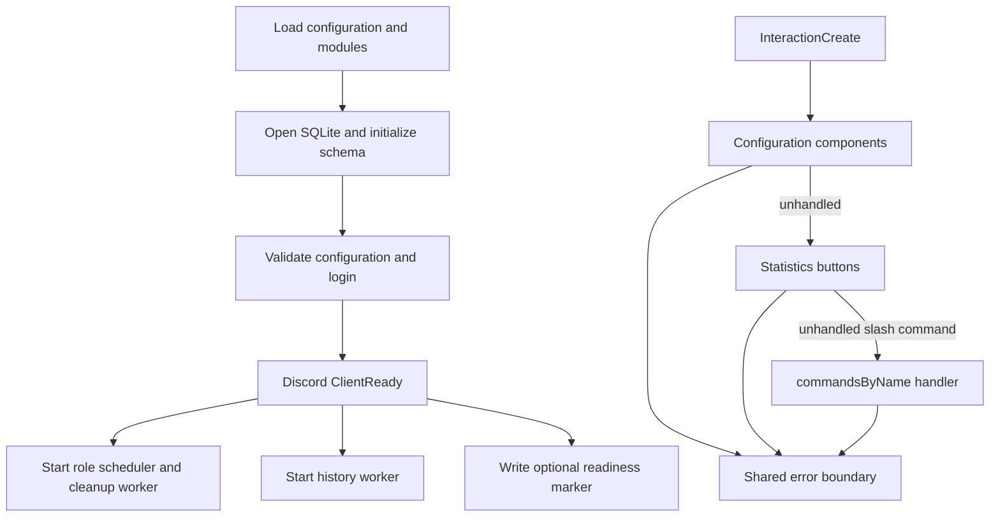
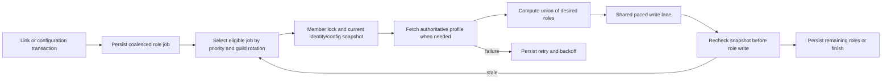

# Architecture and persistence

This describes the checked-in implementation, not the state of a deployed bot or the availability of Discord/OpenFront. For user behavior see [commands](commands.md), [server administration](server-administration.md), and [statistics and history](statistics-and-history.md). Deployment and recovery belong in [operations](operations.md); contributor workflows are in [development](development.md). Return to the [README](../README.md).

## Contents

- [Runtime and source map](#runtime-and-source-map)
- [Startup, events and shutdown](#startup-events-and-shutdown)
- [Identity and access boundaries](#identity-and-access-boundaries)
- [Role reconciliation and queue invariants](#role-reconciliation-and-queue-invariants)
- [API adapter and cache boundaries](#api-adapter-and-cache-boundaries)
- [SQLite schema catalog](#sqlite-schema-catalog)
- [History worker, coverage and delivery](#history-worker-coverage-and-delivery)
- [Event scheduling and delivery](#event-scheduling-and-delivery)
- [Reporting, arithmetic and graphs](#reporting-arithmetic-and-graphs)
- [Community foundation and delivery](#community-foundation-and-delivery)
- [Community source and table map](#community-source-and-table-map)
- [Local performance evidence](#local-performance-evidence)

## Runtime and source map

The bot is one Node.js process, written in strict TypeScript and compiled to ESM JavaScript in `dist/`. Discord interactions, background role synchronization, history collection, and synchronous SQLite access share that process. There is no web server, external queue broker, or separate history service in this repository.

| Source | Responsibility |
| --- | --- |
| `src/index.ts` | Configuration validation, Discord client, event routing, service startup, shutdown, login-failure cleanup |
| `src/config.ts` | Environment loading and defaults; validation of required credentials and default sync interval |
| `src/deploy-commands.ts`, `src/commands/index.ts` | Shared slash-command definitions, registration, name-to-handler map |
| `src/commands/link.ts`, `unlink.ts`, `whois.ts` | Verified identity linking, self-unlink, identity lookup |
| `src/commands/clan.ts`, `clanHandlers.ts` | Clan action definitions and server administration handlers |
| `src/commands/config.ts`, `src/setupConfig.ts` | Interactive drafts, permissions, revision checks, role/channel validation |
| `src/commands/stats.ts` | Statistics selections, interactive page sessions, lazy game/Elo loading and rendering |
| `src/commands/debug.ts`, `dice.ts` | Explicitly authorized diagnostic exports/settings and bounded animated dice rolls |
| `src/commands/support.ts`, `errorMessages.ts`, `src/access.ts`, `src/utils.ts` | Safe replies, errors, identity locks, throttles, access decisions and input parsing |
| `src/clanSync.ts`, `src/roles.ts`, `src/queues.ts` | Role reconciliation, desired-role union, paced writes and in-memory locks |
| `src/api.ts`, `src/historyTypes.ts` | OpenFront transport, runtime validation, short cache and wire types |
| `src/db.ts`, `src/historyStore.ts`, `src/backups.ts` | SQLite schema, state transitions, history checkpoints/cleanup, pre-migration snapshots |
| `src/historyCollector.ts`, `historySchedule.ts` | Bounded background history/Elo collection, deletion synchronization and weekly delivery |
| `src/playerStats.ts`, `playerAnalytics.ts` | Exact lifetime counters and bounded filtered-match analysis |
| `src/reporting.ts`, `historyReports.ts` | Coverage/doctor output, recent clan analysis and stored weekly recap analysis |
| `src/commands/statsGraph.ts`, `statsLineGraph.ts` | Text bar charts and dependency-free PNG Elo line graphs |
| `src/deploymentHealth.ts`, `tools/check-deployment-health.mjs` | Process-owned readiness marker and deployment check |

## Startup, events and shutdown

Importing `db.ts` creates the exported database singleton; importing command definitions can therefore open/migrate the database even in the command registration process. Configuration is loaded at module evaluation, so test/environment overrides must precede imports. `validateConfig()` runs in the bot and registration entry points, but it does not remove these import side effects.

The Discord client requests `Guilds` and privileged `GuildMembers` intents and disables automatic mention parsing. At `ClientReady`, it sets its activity, starts role scheduling and history collection, then writes an optional readiness marker. The marker proves this process reached ready; it is not continuous API or queue health monitoring.

The interaction boundary first offers events to configuration, then statistics, then slash-command handlers. Unknown slash commands receive an actionable error. Expected `CommandError`/`OpenFrontApiError` failures receive controlled wording; unexpected failures are logged and receive a generic fallback. An acknowledged slash command edits its own reply and clears embeds/components. An acknowledged component sends a private follow-up so the original message remains intact. Reply failures, including expired interactions, stay within the event boundary.

Member join triggers synchronization only when an effective link exists. Member removal purges that guild's associated player history; it does not delete the identity link. Member role updates can trigger approval-role handling. `SIGINT` and `SIGTERM` clear the process-owned marker, stop role timers, await the history worker, destroy the Discord client and close SQLite. Login failure performs comparable cleanup and sets a failing exit code. Role scheduler stop sets a flag and clears timers; unlike history stop, it does not expose a promise that drains every outstanding role operation.

## Identity and access boundaries

A verified bot-wide link in `linked_users` takes precedence over server-local `guild_links`. Global links accept only `identity_token` or `profile_discord` methods. `/link` verifies a fresh profile, and a public-ID link must match the caller's Discord connection. Token verification is a fresh POST, followed by profile retrieval. Server managers can approve a local manual link; this is not a global ownership assertion.

Global OpenFront IDs are unique. Local IDs are unique within a guild. A local link cannot overwrite a globally linked Discord user or OpenFront ID. Creating a global verified link removes conflicting local claims (same Discord user or OpenFront ID), audits them, purges affected player history and queues reconciliation. Effective-list queries explicitly suppress local claims shadowed by global identity. Self-unlink removes both the global identity and that user's local links across guilds, including when invoked from a DM. Link mutations use transactions and audit records; per-user identity locks serialize asynchronous command verification and unlinking.

Access is intentionally separate from identity ownership:

| Operation | Required authorization |
| --- | --- |
| Open configuration | Manage Server (`ManageGuild`) or configured manager role |
| Use clan management | Configured manager role, including for server owners/administrators |
| Change selected configuration/access settings | Refreshed permission/role checks at the relevant write boundary |
| Use debug exports/toggles | Explicit configured debug role, including for owners/administrators |
| Change a statistics page | Original invoking user, original guild/DM context and original message |

`hasClanAccess`/`hasConfigAccess` force-fetch membership and reread the configured role after the fetch. A menu is not continuing authorization. Slow validation must be followed by a fresh authorization check before persistence or data release. Manager/debug/history settings use revisions; clan drafts compare `configSnapshot()`, which deliberately omits background `last_sync_at` changes.

Clan snapshots serialize explicit configuration fields in a fixed order, because supported legacy tables can have appended columns in a different physical order from a new draft. Config edits stage session copies until Discord accepts the redraw. Durable saves publish the committed revision/snapshot before replying; a rejected reply does not undo or automatically repeat the database write. Safe config diagnostics record action/stage/code/timing and acknowledgement state without raw Discord error objects or webhook tokens.

Configuration sessions live in memory for ten minutes and bind a random session ID to the owner and guild, with at most 200 retained sessions. Statistics sessions also last ten minutes, bind the original message, reject concurrent button loads and retain at most 500 sessions. `ExpiringSessions` releases expired entries even while the bot is idle, with one unreferenced earliest-deadline timer per registry; reaching a cap evicts the oldest inserted entry. Reads do not extend deadlines. Community menus use the same helper with a 200-entry cap and preserve the explicit clock supplied by their callers. Clock changes rearm expiry without renewing the saved deadline. Timers do not keep the process alive. Revoked or expired in-flight menus cannot republish a registry entry; handlers retain post-await liveness checks, including configuration access/redraw boundaries. History-dependent statistics pages recheck history settings revision, identity/link timestamp and deletion tombstones after asynchronous work; invalidation clears cached history, analytics and Elo graph state. Session maps, throttles and locks disappear on restart; database checkpoints and jobs survive.

Whois and statistics lookups that use a saved link recheck that scoped identity and timestamp after profile requests. Statistics also rechecks before its initial reply and subsequent page edits; an unlinked public-ID lookup has no saved binding to revalidate. Already published messages have their own lifetime.

Clan pending and roster reports refresh server membership and recheck the caller's clan access after slow lookups. They verify the saved clan mappings and each returned identity binding before constructing the final page, excluding departed members and stale approvals or links.

## Role reconciliation and queue invariants

`desiredRoles()` computes the union across every configured clan membership. A shared officer role remains earned if at least one configured membership qualifies. Members receive member roles; officer/leader membership can earn officer roles; leader membership can additionally earn a leader role. Approval/join roles belong to server staff; direct sync and queued cleanup do not remove a role configured as an approval role for any clan, even if another clan also maps it as a rank role.

Clan setup/removal and configuration Save/removal share `affectedRoleMemberIds`: one effective-link inventory is intersected with the freshly fetched roster, adding unlinked holders of obsolete rank roles. It runs after the existing permission and mapping checks. The link inventory includes bot-wide identities; the selector restricts queued member IDs to this server. Role helpers remain independent of runtime database initialization; `db.ts` preserves its `managedRoles` export for existing consumers. Roster mismatch markers use the same protection for staff approval roles as reconciliation.

Role scheduling checks due clan configurations every minute, using each mapping's interval and successful-sync timestamp. Cleanup checks every 250 ms and starts immediately. A separate lock serializes a guild/clan sync, and member locks serialize reconciliation for each guild/member. Both direct synchronization and persisted cleanup use the same `PacedQueue`: one role write lane with a one-second gap after completion, including failed writes. Discord's own HTTP rate-limit handling remains in addition to this pacing.

Due mappings in a guild, or the selected page of at most ten mappings for a bulk command, share one initial member fetch through `syncGuildClans`. It acquires selected clan locks in deterministic tag order and traverses members before clans, returning ordered per-clan result/error buckets. Duplicate tags are deduplicated. The single-clan wrapper remains compatible. Each guarded member operation still calls the normal profile adapter: adjacent reads reuse its 15-second cache, while slow awaited work permits expiry. There is no pass-long profile memo or parallel role-write lane. Bindings are reread after awaited work; each pending-invite summary retains its own final fresh roster. A shared initial fetch failure cannot advance any timestamp; a clan-wide finalization failure stays visible without advancing that clan's timestamp.

Single-role discord.js REST methods return updated clones and can leave the supplied member unchanged until a Gateway event. After actual role changes, the sequence force-refreshes only that member before the next clan. The same refresh-aware `syncMemberClans` sequence serves member joins and the selected page/tag for `/clan action:sync user:…`, without duplicate role logs. No-write clans reuse their observation and add no targeted fetch. A failed member refresh is retained as an error for subsequent clans instead of using stale roles or recording success. These bounded targeted reads are separate from the initial/final full-roster counts below.

Before recording a successful clan sync, the scheduler rechecks that the mapping still has the same configuration; a pass that fetched members under an older mapping cannot defer the changed mapping's next sync.

When an invite summary is needed, sync refreshes the server roster once and rechecks each pending member's approval role and identity binding before publishing. A failed roster refresh prevents publication and a successful-sync timestamp. Individual approval notices likewise recheck current membership and binding before sending.

Persisted `role_jobs` coalesce to one job per guild/member. Enqueue unions current managed roles, explicitly supplied obsolete roles and roles remaining in an older job; replaces its UUID version; resets retry state; preserves its original creation time; and never lowers existing priority. Unlink/ownership cleanup uses elevated priority 10. Each successful cleanup turn makes at most one actual role write, persists remaining roles, then lets other work compete. Obsolete ranks are revoked before grants. Missing members (`10007`) and absent guilds finish the cleanup job; transient failures retain it.

Clan configuration Save/removal batches only local enqueue preparation: one unchanged mapping inventory and two reusable job statements serve the affected roster inside the existing synchronous transaction. Each member's previous job is still read separately, preserving obsolete roles and ordered duplicate input. Queueing remains before mapping replacement/deletion so both old and proposed roles are reconciled. A failed batch rolls back earlier jobs, configuration and history cleanup together. This changes no role-write pacing or external request behavior.

Both persisted-job selection and the in-memory write lane rotate guilds within priority. Strict higher-priority selection means ordinary work can wait under sustained higher-priority load; fairness is not a universal maximum-latency guarantee. Persisted failures back off from one minute exponentially to a one-hour cap. Completion/progress/retry updates include the job UUID, so a stale pass cannot consume a newly enqueued replacement.

Before committing a queued write, the worker rereads job version, effective link ID/link timestamp and the full set of clan configurations. Direct clan sync also rechecks the link binding after profile retrieval and the full configuration set at each paced write, because another clan can require the same role. Before publishing a role-change log after an awaited write, both paths recheck the original configuration and identity binding. A profile API failure does not justify stripping roles as if membership were empty. Removed mapping roles are carried into cleanup jobs so they can still be revoked after the mapping disappears. Preserve all of these checks when adding a new mutation path.

## API adapter and cache boundaries

`OpenFrontApi` wraps `fetch` with JSON acceptance, a 15-second abort timeout, typed network/timeout/HTTP/response errors and endpoint-specific runtime validation. An abort while reading the response body is reported as a timeout, and a failed read is not cached. Types alone do not validate external JSON. Missing players/clans and known empty pages are distinct from transport errors or malformed results. IDs are encoded as URL segments, filters are allowlisted and dates normalize to canonical UTC before caching/storage. Cursor values remain opaque.

Public reads share in-flight work and successful short-lived results (default 15 seconds, maximum 500 entries). The cache owns the private loader's freshly parsed/normalized value, and every initiating, shared and cached caller receives a defensive structured clone. Errors are not inserted as normal cached values. `fresh: true` bypasses both cached and pending reads; generation checks prevent an earlier slow request from replacing a newer fresh result. Cache entries are process memory, keyed by endpoint/query; verification and diagnosis must deliberately request freshness. Token verification is not a reusable cached public read. Public API caching does not establish that a player is online or that a tagged historical appearance proves identity ownership.

Each API instance admits at most eight active loaders and 64 waiting loaders by default. Waiting work is FIFO with a two-second monotonic deadline; elapsed waiters never start transport, even if timer dispatch is delayed. Ordinary same-key readers coalesce before admission, while fresh requests remain distinct. Generations are assigned before waiting, so an older completion cannot replace a newer invocation, including a rejected newer verification. A slot covers network, body consumption/cancellation, validation and normalization. Identity-token validation holds one slot across its existing bounded audience attempts. Slots release on every success/failure; no extra retries are introduced. Queue overflow/expiry produces a controlled `OpenFrontApiError` with reason `busy`/`queue_timeout` and the existing safe retry-later message. Queued timers are unreferenced and cancelled when work starts. Constructor overrides are `maxActiveRequests` (positive integer), `maxQueuedRequests` (nonnegative integer), and `queueTimeoutMs` (integer 1–2,147,483,647); there are no new environment variables. Limits are per process/instance and do not replace worker budgets, command limits or Discord role pacing.

An earliest-expiry frontier avoids full cache scans before any entry can expire, and new insertions lower it after a clock rollback. Evicting the earliest entry may leave a conservative frontier that causes one harmless early sweep; it cannot extend a cached result's lifetime.

Player lifetime profile statistics, cursor game history, player session history, paged clan sessions, ranked leaderboards and recently deleted players are separate adapter contracts. Do not substitute one response shape for another. Leaderboards use exact public IDs and independent `1v1`/`2v2`/`ffa` ladders; bounded scans qualify absence when exhaustion has not been established.

A leaderboard page-bound error establishes exhaustion only when the requested page exceeds a valid stated upper bound; other HTTP 400 responses remain errors.

### Implemented HTTP contracts

These are the paths and validation rules in [the adapter](../src/api.ts), relative to `OPENFRONT_API_BASE`. They describe the bot's supported contract, not a claim that a live endpoint was checked during documentation work.

| Method and path | Inputs and response contract | Absence and bounds |
| --- | --- | --- |
| `GET /public/player/{publicId}` | Profile metadata, optional Discord `user`, clan memberships, optional statistics tree | HTTP 404 returns `null`; supplied user/clan fields are validated rather than accepted as ownership by name |
| `GET /public/clan/{tag}` | Tag normalized uppercase; validates clan name/tag/description and optional nonnegative member count | HTTP 404 returns `null`; no authenticated complete roster is fetched |
| `GET /public/player/{publicId}/games` | Optional `filter`, `type`, opaque `cursor`; validates `{ results, nextCursor }` and each game's result, start, duration, map, mode/type, player count, name/tag | HTTP 404 returns `null`; at most 100 rows; next cursor must be null or nonempty |
| `GET /public/player/{publicId}/sessions` | Same filters/cursor, optional ISO `start`/`end`; validates session game identity, start/end, type/mode, client identity, recorded name/tag and boolean result | HTTP 404 returns `null`; when both dates are supplied, start must precede end; at most 100 rows |
| `GET /public/clan/{tag}/sessions` | Required ISO bounds no more than one day apart, numeric `page`/`limit`; validates results and exact echoed page/limit with total | HTTP 404 returns `null`; pages 1–200, limits 1–50; at most the requested limit of rows |
| `GET /leaderboard/ranked?page=N` | Independent arrays for `1v1`, `2v2`, `ffa`; exact `public_id`, finite `elo`, positive safe-integer `rank` | Pages 1–200 at adapter level; required `1v1` array, missing newer ladders treated as empty; at most 100 rows per ladder |
| `GET /public/players/recently-deleted` | Optional ISO `since`; validates an array of public IDs and deletion timestamps | Maximum 100,000 rows; used with a fresh read by deletion synchronization |
| `POST /public/identity_token/validate` | JSON `{ token, audience }`; requires a valid public ID on successful validation | Tries the decoded audience (or fallback), `ofstats.io`, and `trackerfront.io` without duplicates; HTTP 400/401/403 advances to the next audience, then returns `null` if none validates |

The token's decoded audience is a request hint, not local proof of a valid signature. The upstream validation response establishes the verified ID, then `/link` retrieves that account's fresh profile. The bot does not persist the token itself.

Leaderboard `hasMore` follows whether any ladder returned at least 50 rows. A specific HTTP 400 page-bounds message is recognized as an exhausted page; unrelated 400 responses remain errors. Interactive rating search defaults to three pages and a between-page ten-second budget, with an internal maximum of five pages. The background collector separately bounds its rotating scan to 100 pages. Those three limits have different callers.

Other non-success HTTP statuses become controlled API errors. Transport timeout/network errors and invalid JSON/schema are also distinct internally; user replies go through the centralized safe formatter. See [statistics coverage](statistics-and-history.md#filtered-match-statistics) for how later-page failures retain partial samples.

## SQLite schema catalog

`BotDatabase` uses Node's built-in synchronous `DatabaseSync`, creates the database directory, takes a backup before initialization, sets a 5,000 ms busy timeout and initializes schema inside `BEGIN IMMEDIATE`. There is no ORM or numbered migration directory. History page writes use a savepoint, including when nested in a caller transaction, so partial pages roll back atomically. The implementation does not declare SQL foreign keys; cleanup and cross-table consistency are application responsibilities. Do not assume a transaction remains isolated across asynchronous awaits.

Types below are SQLite storage types; IDs are `TEXT`, timestamps are normally UTC ISO `TEXT`, JSON payloads/role lists are `TEXT`, toggles and counters are `INTEGER`, and ratings are `REAL`.

| Table | Key/uniqueness | Stored fields and purpose |
| --- | --- | --- |
| `linked_users` | PK `discord_id`; unique `openfront_id` | `openfront_username`, `linked_at`, `verified_method`; verified bot-wide ownership |
| `guild_clan_configs` | PK `(guild_id, clan_tag)` | Member/officer/leader/join role IDs, log channel, sync interval, last successful sync; multiple clans per guild |
| `guild_links` | PK `(guild_id, discord_id)`; unique `(guild_id, openfront_id)` | Local account approval, username, link timestamp and verification method |
| `link_audit` | Integer PK `id` | Nullable `guild_id`, actor, subject Discord ID, action, old/new OpenFront ID, creation timestamp; indexed by subject/id and guild/id |
| `role_jobs` | PK `(guild_id, discord_id)` | JSON `role_ids`, UUID `version`, attempts, epoch-ms `available_at`, bounded last error, priority, epoch-ms creation time |
| `guild_settings` | PK `guild_id` | Required manager role and optimistic revision |
| `guild_debug_settings` | PK `guild_id` | Nullable debug role, revision, `verbose_errors` (default 0), `ephemeral_replies` (default 1) |
| `legacy_manual_links` | PK `discord_id` | Quarantined old manual identity with OpenFront ID, username, original link time and migration time; not an effective live link |
| `history_settings` | PK `guild_id` | Revision, clan/player history toggles, collection/weekly toggles, channel, poll interval, retention, weekly day/hour/timezone, internal `weekly_since` |
| `history_clan_matches` | PK `(guild_id, clan_tag, game_id)` | Canonical game start and validated session JSON; time index `(guild_id, game_start)` |
| `history_player_matches` | PK `(guild_id, public_id, game_id)` | Associated Discord ID, canonical game start and session JSON; time/public-ID/identity indexes and covering `(guild_id, public_id, discord_id)` inventory |
| `history_observed_elo` | PK `(guild_id, public_id, ladder, hour_bucket)` | Nullable associated Discord ID, observed UTC timestamp and rating; time/public-ID/identity indexes and covering associated-member inventory with `discord_id IS NOT NULL` |
| `history_jobs` | PK `(guild_id, kind, subject)` | Optional Discord ID and link-time `identity_version`; start/end, page/cursor, next attempt, attempts/error, monotonic work order; subject/work-order/identity indexes and due range `(guild_id, next_attempt)` |
| `history_coverage` | PK `(guild_id, kind, subject, start, end)` | Completed source window and collection timestamp; kind/subject and retention `(guild_id, end)` indexes; independently proves collection completeness |
| `history_weekly_deliveries` | PK `(guild_id, period_start, period_end)` | Destination channel, deterministic nonce, status, attempts/backoff, message ID and error |
| `history_meta` | PK `key` | String metadata: migration marker, deletion checkpoint/error, Elo scan page/backoff/error, per-guild errors and weekly fairness timestamps |
| `history_deleted_players` | PK `public_id` | Deletion timestamp; tombstones prevent recollection/observation of deleted identities |
| `community_settings` | PK `guild_id` | Optimistic revision, milestone announcement toggle/channel, exact decimal threshold arrays stored as JSON text |
| `community_deliveries` | PK `id`; unique `(delivery_key, part)` | Guild/destination/kind/subject/revision, due and retry times, five-minute lease, status, definite failure count, resulting message ID, bounded diagnostic and reconciliation flag; due, lease, subject and retention indexes |
| `community_guild_work` | PK `guild_id` | Monotonic delivery work order for persistent fairness across busy guilds |

Schema defaults for an unsaved guild: clan/player history enabled, collection and weekly delivery disabled, 15-minute polling, 90-day retention, Monday 12:00 UTC. `getSettings()` synthesizes revision 0 without inserting a row. Saving validates toggles, polling 5–1440 minutes, retention 14–365 days, weekday 0–6, hour 0–23 and an IANA timezone. Weekly delivery requires collection plus a channel.

### Migration and backup behavior

Every database construction invokes the backup helper for an existing nonempty on-disk database, even if no schema change is ultimately necessary. It skips new/empty and `:memory:` databases. `VACUUM INTO` creates a consistent snapshot including committed WAL contents, checks `PRAGMA integrity_check`, then renames the partial file. Snapshot names include a hash of the database's resolved path, timestamp and UUID. Default retention keeps five snapshots for that database only. An unsuccessful snapshot aborts initialization/migration rather than proceeding unprotected; this is startup protection, not scheduled off-host backup.

Initialization detects the former single-key clan table, copies it to the compound-key layout, preserves column meaning explicitly and adds missing join-role fields. It adds queue priority/creation and debug toggle columns to older layouts, initializes missing creation times, and normalizes legacy SQLite date strings for links/sync timestamps. Former global `admin_manual` links lack guild provenance: they are copied to `legacy_manual_links`, audited as revoked, removed from global ownership and queued for reconciliation. Operators must create a new appropriate link; migration does not guess a guild.

A history metadata marker converts the old Monday 09:00 `America/Bahia` schedule to noon UTC once, increments affected revisions and resets `weekly_since` for enabled schedules. Later custom settings are preserved. See [operations](operations.md) for backup handling and restore procedures.

## History worker, coverage and delivery

The collector runs immediately and every minute, prevents overlapping ticks, defaults to eight API requests per tick (option clamped 1–50), and is independent of the role lane. It prunes retention before selecting work. Only explicitly saved collection-enabled guilds present in the client cache receive collection snapshots. Membership is refreshed, bots and absent users are excluded, and stale player associations are purged.

New jobs begin seven days back at a UTC day boundary and advance through at most one-day windows. Clan jobs use pages of 50; player jobs use opaque cursors and public Team sessions whose recorded clan tag belongs to the configured set. Both reject out-of-window responses. The API's inclusive upper boundary is filtered locally into half-open `[start, end)` storage windows, preventing boundary double counting. Repeated cursors, empty nonterminal clan pages and a 200-page cap leave coverage incomplete and retry rather than falsely marking success.

Each guild's job inventory is ensured in one batch. Indexed queries read only supplied kind/subject bindings and player tombstones; unchanged jobs cause no insert attempt or checkpoint update. Changed player bindings still purge their old player history/Elo/coverage, and missing jobs keep the same seven-day initial window. Duplicate inputs follow sequential binding changes. All resulting purges and inserts share one savepoint, so a failed replacement cannot leave a partial inventory or discard a caller's outer transaction.

One page is the work unit. `last_work` is a monotonically increasing order value; least recently worked jobs rotate before another page is selected. A successful terminal page records coverage; a failed page keeps its exact checkpoint and backs off to a one-hour cap. When caught up (within one minute), jobs revisit the previous UTC day after the poll interval, allowing later corrections. This initial seven-day backfill does not automatically reconstruct the entire retention period.

Player storage requires a current link ID and original link timestamp, unchanged settings revision, unchanged configured clan set, a live job checkpoint and a nondeleted player. Membership is force-checked after a player response. These are rechecked after awaits so stale API work cannot resurrect history after unlink, mapping changes, settings changes or shutdown.

The same current-job check protects failure handling: a late API error cannot back off a replacement job, and a late unknown-member response cannot purge history belonging to a replacement identity.

Deletion synchronization runs at most daily when player history settings/observations require it. The deletion feed retains seven days; requests start at least one minute inside that boundary to allow transport time. A missing/future checkpoint, or one earlier than that safe request cutoff, causes all stored player match/Elo history to clear before refreshing the feed. This includes gaps shorter than seven days that the safety margin would otherwise skip. A failed feed does not advance the success checkpoint and blocks player collection and weekly delivery while clan work can continue. Deleted public IDs are tombstoned and removed across guilds. The code does not expire these tombstones automatically.

One shared leaderboard page per eligible tick supplies Elo observations for all enabled guilds' linked humans; the scan page/backoff lives in metadata and is bounded to 100 pages. It reserves capacity for match work. Per guild/player/ladder/hour, the latest observed timestamp wins. These are snapshots of leaderboard observations, not recovered historical ratings or a per-game Elo reconstruction. Public profile observations can also exist without a membership association; they expire by retention.

Elo retention pruning reads the relevant guild settings in one joined query, then applies each guild's own cutoff and the existing default and bounds.

Leaderboard observations sharing one timestamp are saved per guild through `recordEloBatch`: settings and matching tombstones are read once, the insert is prepared once, and retention runs once after the batch. Every ladder/hour observation still receives its own upsert with the existing latest-timestamp and association-preserving rules. A failed write or retention pass rolls back that guild's batch; no savepoint spans an await. Single observations retain `recordElo` compatibility, including DM behavior and deleted-account suppression.

Identity cleanup uses covering indexes beginning with Discord identity and guild for retained player matches, associated Elo and player jobs. Global unlink and scoped member cleanup can find affected account IDs without scanning unrelated retained payloads. Anonymous Elo and clan jobs are excluded from the corresponding partial indexes. Initialization adds these indexes through the existing backed-up transaction and preserves rows on repeated initialization.

Weekly scheduling uses the selected timezone's civil calendar and DST-aware conversion, independently of the host timezone. The latest due schedule covers the preceding complete local Monday-to-Monday week. `weekly_since` avoids publishing a scheduled period from before weekly delivery was enabled. The worker attempts at most two guilds per tick and rotates guild delivery work separately from collection pages.

The weekly rotation reads each eligible guild's saved work priority once before sorting, rather than issuing database reads from the sort comparator; ties retain the existing snapshot order.

Delivery persists `pending → sending → sent`, with retryable failures returning to pending and a terminal failed state after the bounded attempt budget. Each guild/period has a deterministic nonce. Before retrying a prior attempt, it searches the most recent 100 channel messages for its own report footer marker and records a match as sent; sending also uses Discord nonce enforcement. This reduces duplicate sends but is not an unlimited, transactional exactly-once guarantee across Discord and SQLite. A changed pending destination is failed rather than sent to an obsolete channel. Permission, membership, identity, settings and configured-tag checks happen before sending. Failed deliveries are not automatically retried forever.

### Cleanup boundaries

| Trigger | Effect |
| --- | --- |
| Global relink/unlink | Purges history associated with that Discord identity across guilds; conflicting local claims are also purged |
| Local relink/unlink | Purges that member's associated history in the guild |
| Member leaves | Purges associated player matches/jobs/coverage/Elo for that guild; link remains |
| Add/remove configured clan | Rebuilds guild player matches/jobs/coverage because the eligible historical tag set changed; preserves Elo unless another purge applies |
| Remove clan | Removes that clan's matches/jobs/coverage as well |
| Disable player history | Clears that guild's player matches/jobs/coverage and observed Elo |
| Deletion feed entry | Tombstones the public ID and purges player matches/jobs/coverage/Elo across guilds |
| Retention pass | Removes old clan/player matches, Elo observations and expired coverage; removes old sent deliveries; clamps old job windows to the retention horizon |

Retention is an application deletion policy, not a guarantee that backups no longer contain old rows. Audit, link, settings, quarantine, tombstone and failed history-delivery tables are not generally swept by match retention. Guild removal clears that server's community records; it does not imply removal of unrelated existing history or configuration tables.

## Community foundation and delivery

`BotDatabase.community` initializes inside the same backed-up migration transaction as the existing schema. Focused feature, settings and delivery stores share that SQLite connection. Community mutations use unique savepoints so they compose with identity changes and outer transactions. Database transactions are synchronous and never enclose an awaited Discord/API request. The final registry exposes all 16 commands; `community/runtime.ts` registers event, milestone, bingo and duel work on one service, and `community/interactions.ts` awaits every feature handler before legacy fallthrough.

Community settings synthesize revision 0 before the first save and increment revisions on successful writes. Milestone announcements default off with no channel; game thresholds default to 10/50/100/250/500 and win thresholds to 1/10/25/50/100. Thresholds remain exact decimal strings, validated using BigInt. Private menus share a 200-session in-memory cache, expire after ten minutes, and check owner and guild/channel/message binding. Public persistent controls use saved records instead of private sessions. Community officer actions force-fetch membership before rereading the manager and configured officer/leader role mappings. Announcement configuration uses the existing `requireConfigAccess`; `/clan` and `/debug` retain their existing, independent permission checks.

One non-overlapping `CommunityService` starts at ClientReady, runs immediately and every minute, and drains on shutdown or login failure. Concurrent `runOnce()` callers share the same promise. Each tick grants feature tasks at most eight upstream requests and processes at most four delivery attempts; existing role/history budgets are unchanged. Task starting order rotates, and persisted per-guild work order rotates delivery claims. A task failure leaves the other tasks and deliveries runnable. Feature tasks only enqueue deliveries and must use `takeRequest()`, honor `stopping()`, and recheck effective identity, fresh membership and saved revisions after awaited lookups.

Delivery keys deduplicate each part globally and cannot be reused with another guild, destination, subject or revision. Claims receive independent five-minute leases; stale leases cannot finish or fail a newer claim. Handlers prepare/validate the current subject revision again after Discord lookups. Known messages are edited with create-only fields removed. New sends suppress mentions, include a stable hashed recovery marker, and use a stable decimal nonce with nonce enforcement. The marker uses an embed footer when its field and combined text budgets permit; otherwise it uses available message content space. Existing text is preserved, and a message with no room pauses with instructions to shorten it before retrying. Synchronous subject binding and delivery completion share one savepoint. A failure after Discord accepted a message becomes `needs_review` instead of automatically reposting.

An interrupted `sending` lease or uncertain send requires reconciliation against the most recent 100 channel messages, matching the bot's author ID and exact footer marker or separate content marker line. A recovered message is bound without another post. An unresolved result remains `needs_review`; deliberate retry preserves that reconciliation requirement. This is a bounded recovery mechanism, not an exactly-once guarantee across SQLite and Discord. Definite transient rejections back off for 1, 2, 4, 8, 16, then 30 minutes and pause after ten failures. Missing channels/messages/permissions pause immediately. Missing handlers pause; obsolete revisions cancel. Officer retry operations require the saved guild and revision and cannot revive sent or cancelled work.

Lifecycle hooks are wired through effective-account replacement, unlink, member/guild departure, deleted-account ingestion, and guild/global player-history clearing. Same-account re-verification preserves community deduplication while monotonic link timestamps invalidate stale async observations, including unlink/relink within one clock millisecond. Feature plans extend the identity/account/game-evidence hooks when their personal tables exist. Guild departure already removes the shared settings, deliveries, work order and private sessions. Background pruning removes at most 200 completed/cancelled/failed delivery diagnostics per tick after 30 days; paused/review work remains available for intervention.

## Event scheduling and delivery

`community/events.ts` owns saved event revisions, canonical message binding and transactional confirmed/reserve state. Indexed worker fields track reminder due time, end time, retention time and whether the start-time card closure was queued. Initialization upgrades earlier event rows without resetting existing work on restart. Cancellation records its actual instant for retention; earlier rows without that timestamp use the saved end conservatively. Domain and command checks close signups at `now >= startAt`, independently of worker timing.

`registerEventWork()` extends the existing runtime registration with reminder handlers and rotating event housekeeping for at most eight guilds per tick. Each guild selects at most twenty due reminders, closures, ends and promotions through dedicated range indexes. A fresh roster is shared across that guild's promotion batch, followed by event revision/start rechecks. Promotion inspects at most one hundred confirmed members and two hundred FIFO reserve candidates per pass, retaining the due flag when another pass is needed. A failed roster read leaves promotion due and does not block reminder discovery or another guild.

Due reminders persist deterministic forty-member recipient parts, keyed by event/revision/kind/part, in `community_event_reminder_parts`. Snapshots include only confirmed opt-ins at queue time. Preparation filters each part against current signup state, requests just those member IDs freshly from Discord, then rechecks the revision, current clock and signup eligibility after the await. The shared service prepares again after channel/recovery lookups. Immediately before sending, the reminder handler intersects that membership-verified recipient list with current signup and opt-in state, and checks the event revision and start time again. Parts are never reshuffled after a send, and obsolete or overdue work cancels. The send/edit sanitizers retain only explicit valid user allowlists with empty parsing, empty role lists and disabled reply mentions; ordinary payloads retain the default empty mention policy.

Event publication and card updates are also rendered again at the synchronous send boundary. A draft that has reached its start time is not published, and an update crossing that instant reflects closed signup controls.

The shared eight-request tick budget now covers task work and delivery membership preparation. A handler may declare `requestBudget`; when that kind has due work, housekeeping leaves enough requests for one job. Event reminders reserve three slots, covering two normal fresh lookups and one additional recovery check. Budget exhaustion defers the lease until the next tick without incrementing attempts or discarding reconciliation state. This avoids indefinite starvation from busy feature tasks while preserving the four-delivery-attempt limit and existing history/role budgets. `CommunityTick.currentTime()` supplies a fresh injected clock after awaits; the original `now` remains the tick snapshot.

All command/publication/update cards use `EventStore.participants()` for a twenty-row page and grouped exact occupancy counts, avoiding materializing arbitrary reserve lists or scanning them once per squad. Full `signups()` remains available to callers that need every entry, and `renderEvent()` retains array compatibility. Event management includes reminder diagnostics in its bounded subject lookup and uses the foundation's deliberate retry/reconcile flow with fresh officer authorization.

`/event action:list` uses `publishedPage`: a scalar count capped at 100 establishes at most ten pages, and only the requested ten published event payloads are loaded and decoded. Drafts and other guilds are excluded before paging. The existing start-descending/ID ordering, private reply and invalid-page behavior are preserved. The compatibility `listPublished()` reader remains available for callers needing the capped inventory.

Retention selects at most twenty expired event parents using the retention range index. Each selected event drains at most two hundred signups, reminder parts and delivery jobs per table before removing the parent. The ninety-day threshold is strictly after the actual end/cancellation instant; active drafts are retained. The shared thirty-day completed-delivery diagnostic sweep remains independently bounded. Guild removal clears reminder parts along with the other event records; account unlink does not remove unrelated event signups.

## Reporting, arithmetic and graphs

Lifetime profile counters are decoded in `playerStats.ts` with `bigint` arithmetic to preserve large exact totals. Missing/null values remain unavailable; they do not become zero. Selected game types/modes remain separate, recent windows are not added to lifetime totals, and disjoint buckets must not double-count shared counters. Buildings are lifetime counters even when another statistics page is showing a period/map sample.

`playerAnalytics.ts` performs bounded cursor scans for period/map statistics (default ten pages and ten seconds, configurable within bounded limits), deduplicates game IDs and excludes future games. Completed wins/losses define the win-rate denominator; incomplete results do not become losses. It records whether collection exhausted, crossed the requested boundary, hit page/time limits, looped a cursor or suffered a later API error. A later error can retain an explicitly partial sample; completeness describes the available API history for that selection, not the account's lifetime.

`/stats` ordinary all-time lazy history keeps five games per displayed page, at most 100 retained matches per mode, and at most 20 fetched batches. Period/map history instead paginates the bounded analytics sample and does not apply that separate 100-match browsing cap. Per-session caches and graph buffers are invalidated on identity, history revision or deletion changes. Elo graph reuse keys include the actual selected ladder's observation data, so changed/removed points require a replacement image.

Recent clan reports fetch on-demand API windows independently of persisted collector coverage, with a default 24-request/60-second budget and a 14-day maximum requested range; ordinary public-read caching still applies. Weekly reports instead read stored history and current links/members. They use historical recorded tags and completed public Team sessions, deduplicate games, show completeness explicitly and withhold player rankings until deletion checks are fresh. Top rates require at least three recorded games; only the first eight clan breakdowns display, while totals include all configured clans. These reports are observational summaries, not tournament eligibility or live presence verification.

Weekly reports reuse each clan's decoded rows for both totals and displayed breakdowns. `HistoryStore.getCoverageBySubject` streams ordered intervals through the existing coverage index, retaining one accumulator per requested subject; gap, overlap and clipped-window arithmetic is shared with single-subject readers. A recap needs one clan coverage query and, when rankings are enabled and deletion checks are fresh, one player coverage query. Empty inventories and invalid windows make no coverage query. Streaming uses the SQLite iterator available at the existing Node.js 22.13.0 minimum.

`alignedBarChart()` renders monospaced text bars while distinguishing zero, missing and partial values. `eloLineGraph()` renders a 900×380 RGB PNG directly using buffers, zlib and CRC chunks; it filters invalid points, sorts by observation time, labels UTC axes and returns `null` when no valid points exist. It needs no image service, canvas installation or browser. Coverage and doctor reporting in `reporting.ts` are distinct: coverage summarizes current human membership/link checks; doctor performs read-only refreshed Discord and fresh clan API diagnostics. Coverage refreshes the full roster after profile and clan requests, then computes all counts from current effective links; changed bindings are unexamined rather than reusing obsolete profile results. Both slash and configuration-menu reports refresh access and reject changed mapping/access/history settings before release; menu reports also require the session to remain live. `buildCoverageReport` returns embeds with an `assertCurrent` check captured synchronously from the exact rendered roster and links. Both callers invoke it after final authorization to catch membership/identity changes during either promise handoff, ignoring identities outside the server.

## Curated wheel

`community/wheelPresets.ts` owns the explicit four-map catalog, checked local OpenFront unit/settings types, six approved starter packages and complete compatibility validation. `community/wheel.ts` owns cryptographic package-then-map selection and the SQLite preset store. The `(guild_id,id)` primary key bounds guild reads and revision mutations; `list()` returns at most 50 records. A separate `community_wheel_initialized` marker persists initialization even when every preset is removed. Initialization and writes use composable synchronous transactions, with no Discord await inside them. Guild purge clears both tables.

`commands/wheel.ts` owns the five slash actions, five-second per-user cooldown before draws, fresh authorization, private sessions and copied event draft flow. `wheelForms.ts` owns complete hosting text, cards, three five-field modal sections and human-readable parsing. At most two 25-option select menus cover the 50-preset guild limit. All edits validate before preview; explicit save checks the original revision. Private modal snapshots cannot retarget an edited preset through a later selection. The prefix is checked before feature-specific interaction-type methods.

A public spin has no session controls. A single fresh member lookup both establishes membership and decides whether to offer an officer-only private draft follow-up. That session copies selected settings into a compact summary below the event's 500-character budget and preserves instructions in the 1000-character description. The shared event draft opener accepts an optional `assertSourceCurrent` callback, executed after its fresh officer lookup and before persistence; wheel uses it to reject a private session revoked/expired during the await without fetching the member twice. Subsequent source preset edits/removals cannot alter the copied draft.

## Shared bingo state and evidence

`community.bingo` persists immutable 25-cell board definitions, a free center, current evaluated cells/lines and separate historical notification keys. A partial unique index permits one active board per guild. Archive increments the revision and cancels old board deliveries; public controls must reread this state. Manual approvals use `setManualApproval(guildId, boardId, revision, index, approved, actorId, reason, now)` and retain an audit reason. Claim queues, officer authorization and transport are owned by the bingo interaction layer.

The pure collector reads only supplied retained sessions and latest current availability. Game keys identify account/game pairs, contributors use distinct accounts, and shared-game progress uses the largest distinct-account group. Game evidence includes captured effective-link `linkedAt`. Canonical persistence rechecks the retained row, current effective identity, deleted-account suppression, configured tag, Public/Team mode, valid end, board start/closure bounds, retention and deletion-sync health. Availability uses each member's current nonempty windows and latest saved timestamp; account unlink preserves it. Explicit clears, account deletion, departure, history retention and disabling collection remove the appropriate evidence and recompute current cells immediately. Historical notification keys survive line loss/regain.

### Bounded producer contract

The bingo worker must use one fresh full current human-member inventory per guild. Call `syncEvidenceEligibility(guildId, bindings, memberIds, clanTags)` with eligible effective game bindings, all current human IDs (including unlinked members), and configured tags. Its normalized fingerprint dirties sources only when eligibility changes. Source triggers also advance a guild revision for actual retained-session and availability changes; unchanged session upserts do not write rows. Privacy hooks advance the generation even when an awaited scan has not committed evidence yet.

After syncing fresh eligibility, `needsEvidenceRefresh(guildId, boardId, now)` checks source/settings/health changes and the next retention deadline. An unchanged board skips retained payload reads. Capture `evidenceSnapshot(guildId, boardId, now)` before awaited work that could commit evidence, then open `beginEvidenceStage(snapshot, now)`. The trusted producer `stageEvidencePage(stageId, identities, clanTags, currentHumanIds, now, limit)` reads, parses, validates and stages at most 200 canonical source rows per call. Its phases are `games`, `availability`, then `ready`; it owns its indexed cursors and persists staging separately from the active generation. Pass actual current time on every call and sync fresh membership/effective bindings/tags after awaits before continuation or finalization. Changed sources, privacy generations, board replacement, deletion health or retention deadlines reject old stages.

Only `finalizeEvidenceStage(stageId, now)` publishes a ready stage. It atomically changes the active evidence-generation pointer, stores the processed source version and retention deadline, and evaluates the 25 cells from maintained aggregate counters and indexed shared-game group sizes. It performs no per-game payload reads/parses and never consumes an accumulated N-row array. No partial stage is visible as current board progress. Generation-aware database triggers maintain aggregate counts through insertion, correction and removal. The old generation becomes retired and is cleaned in bounded batches; no transaction spans an awaited request. `readGamePage` remains an indexed reader for synchronous compatibility and diagnostics, with a 200-row maximum and one unparsed lookahead.

`replaceEvidence(...): void` keeps synchronous untrusted-array compatibility, including optional snapshot checking and per-item canonical validation. Its work is proportional to the supplied input, including N retained-payload rereads; it is not the production bounded worker path. `refresh` corrects/removes at most 200 existing current-generation observations per call and keeps a source-versioned keyset cursor. Routine retention likewise removes at most 200 evidence rows per callback. These paths do not mark a changed, unscanned source complete. The worker finishes a fresh staged replacement before releasing automatic results, including after a fresh inventory change. Until that happens, mixed/automatic line notification keys are withheld so partial correction cannot consume a future legitimate completion; wholly manual lines remain eligible. `activeBoards(afterId, limit)` supplies bounded board traversal, and the worker owns fair continuation scheduling.

Completion intents use kind `bingo_complete`, board subject/revision and key `bingo:${boardId}:${line}`. Parts 0–4 are rows, 5–9 columns, 10–11 diagonals and 12 the complete board. The handler must reread current board state, health and corresponding line before sending; notification keys remain recorded if a completion becomes obsolete. Publication/update handlers must bind the returned message synchronously through the shared delivered callback and validate board/channel/revision. This state layer sends no Discord requests.

Retired/abandoned generations drain at most 200 evidence rows per generation, up to 20 generations per tick; idle stages become abandoned after 24 hours. Explicit privacy removal deletes its indexed affected scope immediately without reconstructing payloads and invalidates staging. Guild cleanup removes sources after availability DELETE triggers have run. Archive cleanup examines at most 20 boards and drains at most 200 children from each owned table and 200 deliveries per board per tick. It retains the parent until all children are removed. Member/account/time indexes support privacy and retention, and delivery cleanup uses the existing guild/kind/subject index.

Regression evidence uses real SQLite: 451 game payloads are parsed exactly once across staged pages of 200/200/51; finalization performs zero retained payload reads/parses and zero evidence-row loads. Dirty refresh/retention is limited to 200 observations per call. Unchanged compatibility replacement performs zero row writes but retains its canonical payload reads; clean refresh performs no retained payload reads. Equivalent session upserts/inventories perform zero row writes. Archive audit and abandoned-generation cleanup drain 451 records as 200/200/51. See `test/bingo-evidence.test.mjs`.

When game collection is disabled or deletion health is unavailable, a fresh evidence stage skips game paging entirely and processes account-independent availability immediately. Snapshot/inventory guards still apply. Restoring observed game health invalidates that stage's source snapshot and requires the normal bounded game scan before automatic game progress becomes current again.

### Persistent dice duels

`community.duels` owns guild-scoped invitations and saved results separately from the existing `/dice` command. `invite(binding, challengerId, opponentId, now, rematchOf?)` creates revision 1 with a two-minute deadline. A unique `(guild_id,discord_id)` participant table claims both pending slots atomically; a separate durable challenger cooldown ends at exactly 30 seconds. Invitation creation looks up only the two requested participant slots and expires their overdue invitations before claiming new ones, so correctness does not depend on a background sweep. Rematches require a saved resolved tie and the same pair of participants; either participant may become the challenger and fresh opponent consent is still required.

`resolve`, `decline` and `cancel` reread the saved guild record and authorize the opponent or challenger before considering its status. For a pending invitation at the deadline (`now >= expiresAt`), any authorized action records Expired. Authorized duplicate actions return the existing terminal record; accepting an already resolved duel never draws again. Acceptance atomically claims the pending revision before calling cryptographic `randomInt(1,7)` twice and saving the ordered challenger/opponent rolls. RNG failure or invalid injected values roll back the whole transition. These savepoints are synchronous and compose with outer transactions. Results must be committed before any awaited Discord animation or edit.

`get(guildId, duelId)` returns the saved record or null. `bindMessage(guildId, duelId, revision, messageId)` compares the current revision, allows an identical binding retry and rejects movement to another message. A binding does not advance the revision; each terminal transition advances it once. The interaction layer must freshly verify both current human memberships, then reread this state and match the saved guild/channel/message binding after awaited work. The store deliberately owns no Discord calls, buttons, delivery worker or membership cache; those are downstream transport responsibilities.

`expire(now)` returns at most 200 newly expired saved records ordered by deadline/id, including their canonical message binding for downstream edits. It does not repeat prior expirations; each transition persists its canonical update job in the same savepoint before any awaited edit. `resolvedAt` is the terminal instant for all terminal statuses: acceptance/decline/cancellation use their action time, and expiry uses the actual deadline even when discovered late. Pruning removes at most 200 terminal records strictly after 30 days, 200 transport closures and 200 elapsed cooldown rows per tick. Partial deadline/retention indexes and the cooldown-time index serve those bounded selections without temporary sorting; 451-row regression fixtures drain as 200/200/51.

Member departure removes that member's pending invitation and both participant slots, plus their challenger cooldown, retaining only minimal canonical transport closure metadata. Saved terminal outcomes retain their thirty-day lifetime. Guild removal clears the server's duel, participant, cooldown and closure tables. Account replacement, unlink, deletion and game-evidence cleanup preserve these account-independent duels. No currency, bets or standings are stored. See `test/duels.test.mjs` for real SQLite transition, boundary, rollback, reopen and cleanup coverage.

## Duel public controls and activation

`commands/duel.ts` owns the server-only command and `clit-duel:` buttons; `duelViews.ts` renders saved records. The shared community chain awaits every handler, including bingo before duel. Commands fetch the exact one/two human members via one fresh gateway request, retain a scoped in-flight invalidation guard, then synchronously reread actor, canonical binding, status and deadline before the state transition. No transaction spans a Discord await.

Invitation creation and every terminal transition create stable delivery jobs atomically. `duel_publish` starts disabled, completion/reconciliation binds once and queues its `duel_update`. The optional synchronous final-delivery hook runs after all awaited lookups and returns a newly saved-state-derived payload for the same canonical target. Its duel activation stores `activated_at` once and moves the acceptance deadline to activation + two minutes; creation + two minutes remains the hard unactivated wait bound. Existing direct synchronous store operations keep their original unbound two-minute semantics. Activation leaves the invitation revision unchanged so the current leased update remains valid. Failed requests/retries preserve activation and saved rolls.

Member deletion creates a minimal transport-only closure before removing pending personal data. A send already in flight can bind to that closure and close the canonical card without restoring participant IDs. Indexed, bounded expiry/retention and the shared four-send/eight-request limits remain in force. Published messages and database records retain separate lifetimes.

## Community source and table map

Paths below are relative to `src/`. Feature builders all use Guild context. `commandError.ts` supplies the same error constructor re-exported by `commands/support.ts`, keeping domain validation independent of database singleton imports.

| Sources | Ownership |
| --- | --- |
| `community/store.ts`, `transactions.ts`, `types.ts`, `settings.ts` | Shared SQLite initialization, composable synchronous savepoints, contracts, exact thresholds and settings revisions |
| `community/access.ts`, `sessions.ts`, `interactions.ts`, `lifecycle.ts` | Fresh officer authorization, bounded private menus, awaited central dispatch, identity/member/account/guild cleanup |
| `community/service.ts`, `runtime.ts`, `deliveries.ts` | One bounded worker, feature registration, saved leases/markers/nonces, reconciliation, synchronous final-delivery and stop callbacks |
| `community/time.ts`, `availability.ts`; `commands/availability.ts` | Local timezone/DST projection, recurring windows, private editing and public count-only suggestions |
| `community/events.ts`, `eventDelivery.ts`; `commands/event.ts`, `eventViews.ts` | Atomic capacity/reserves/squad moves, opt-in reminders, durable publication and bounded participant views |
| `community/onboarding.ts`; `commands/onboarding.ts` | Enrollment tokens, fresh derived checklist and ten-member private officer queue |
| `community/wheel.ts`, `wheelPresets.ts`; `commands/wheel.ts`, `wheelForms.ts` | Validated hosting packages, cryptographic draw, explicit private saves and copied event settings |
| `community/milestones.ts`, `milestoneCounters.ts`, `milestoneWorker.ts`; `commands/milestones.ts` | Exact counters, quiet baselines, revision-bound awards, globally paced account polling and bounded diagnostics |
| `community/bingo.ts`, `bingoEvidence.ts`, `bingoGenerations.ts`, `bingoClaims.ts`, `bingoLifecycle.ts`, `bingoWorker.ts`; `commands/bingo.ts`, `bingoViews.ts` | Frozen objectives, canonical retained evidence, staged aggregates, private claims/audit, membership freshness and deduplicated progress |
| `community/duels.ts`, `duelTransport.ts`, `duelWorker.ts`; `commands/duel.ts`, `duelViews.ts` | Consent/slot/cooldown state, saved rolls, canonical activation and transport/closure recovery |

The schema catalog's three foundation tables are extended by every table below. IDs are text; community instants are epoch-ms integers. Lifetime counters/thresholds are exact decimal text and BigInt. Bingo evidence cardinalities use SQLite INTEGER aggregates and numeric target/progress interfaces, independently of lifetime statistics.

| Tables | Keys and purpose |
| --- | --- |
| `community_availability`, `community_availability_changes` | Guild/member keys; local timezone/windows JSON and monotonic revision, plus latest submission instant; indexed change-time paging |
| `community_events` | ID; guild/channel/message, revision/status, UTC schedule, due/retire columns and JSON including squads/settings; indexed due work, guild/start and retirement |
| `community_event_signups`, `community_event_reminder_parts` | Event/member uniqueness with sequence, state, squad and opt-in preference; member/capacity/count/page indexes; saved bounded reminder parts |
| `community_onboarding` | Guild/member key; clan, enrollment/completion/account and invalidation token; page, identity and account indexes |
| `community_wheel_presets`, `community_wheel_initialized` | Guild/ID revision and validated JSON; guild marker prevents reseeding deliberately removed starters |
| `community_milestone_observations`, `community_milestone_thresholds` | Guild/account exact counters/current identity and guild/account/metric/threshold baseline/award; identity/account indexes |
| `community_milestone_candidates`, `community_milestone_account_attempts` | Guild/member generation and due/backoff; public-account global polling gate, indexed due and cleanup |
| `community_milestone_intents` | ID; captured identity/generation/settings revision and combined award payload; guild/account/identity/retention indexes |
| `community_bingo_boards` | ID; unique active board per guild, immutable cells JSON, revision/binding, generation pointer, lines/source/expiry/draft owner; guild/status/page/retention indexes |
| `community_bingo_sources`, `community_bingo_generations` | Guild source version/eligible inventory; staged generation snapshots/cursors/status, indexed by board/guild/cleanup |
| `community_bingo_evidence`, `community_bingo_totals`, `community_bingo_groups` | Generation/evidence uniqueness and identity/account/guild/time indexes; maintained generation counts and contributor/shared-game groups, indexed largest group |
| `community_bingo_approvals`, `community_bingo_audit`, `community_bingo_notifications` | Board/cell approval, ordered private audit, board/line notification key independent of current progress |
| `community_bingo_claims`, `community_bingo_public_state` | Claim ID and unique pending board/cell/actor; scoped page/member/archive indexes; public payload signature/sequence |
| `community_duels`, `community_duel_participants`, `community_duel_cooldowns`, `community_duel_closures` | Saved rolls/deadlines, unique guild/member pending slot and cooldown, minimal closure transport; indexed expiry/retention/guild lookups |

Milestone diagnostics use `community_delivery_diagnostics`, a partial `(guild_id,kind,due_at)` index restricted to failed/paused/needs_review status. The private menu requests `LIMIT 11 OFFSET page*10`, decodes ten jobs, and uses the extra row for Next. Ordering remains `due_at,rowid`; later pages traverse preceding matching diagnostics, without materializing unrelated retained history. Retry still validates the selected job's kind/guild/revision/destination/current settings and fresh access.

Milestone candidate inventory synchronization reads current bindings once and skips observation lookups and candidate writes for unchanged identities. Every supplied binding still passes the current-identity check. Removed candidates invalidate captured generations; replacements retain their existing due/backoff state while advancing generation. The in-memory inventory follows duplicate input order, and writes/removals remain inside the composable savepoint. This reduces inventory maintenance work without removing the worker's separate identity/deletion checks or polling limits.

The wheel catalog was deliberately checked against sibling `OpenFrontIO-main`: `packages/engine-api/src/game/Maps.gen.ts` supplies four supported maps; `packages/engine-api/src/game/GameTypes.ts` supplies difficulty, teams, modes, map sizes and all sixteen unit strings; `packages/engine-api/src/Schemas.ts` supplies hosting field types and bot/nation bounds. Future catalog changes should review those sources and validation/tests together. This records provenance for the checked catalog, not automatic or ongoing upstream parity.

## Local performance evidence

These are representative local observations and operation/query-plan proofs, not timing guarantees or ordinary test thresholds. See the covering [development tests](development.md#community-regression-inventory-and-performance-evidence).

| Path and workload | Observed improvement / boundary |
| --- | --- |
| Availability, 129 zones / 258 interleaved members | Per-invocation zone projection reuse reduced Intl calls 93,810 → 46,905; representative elapsed 1.2649s → 0.5511s. Cache-churn correctness remains tested. |
| Event card, 10,001 participants | Full return of 10,001 signup rows → 20 displayed rows plus two aggregate rows with indexed plans; totals/paging preserved. |
| Settings list, 1,000 rows | Queries 1,001 → 1. Twelve-iteration median 8.9947ms → 1.7075ms; p95 30.0878ms → 2.4469ms. |
| Milestone diagnostics, 12,000 mixed rows / 10,000 guild rows | Legacy list decoded 10,000 rows; new page returns 11 and decodes ten. SQLite EXPLAIN searches the partial index by guild/kind, with no table scan or temporary sort. |
| Milestone inventory, 1,000 unchanged bindings | Inventory statement executions 2,001 → 1; observation reads and no-op UPSERTs each 1,000 → 0. Identity-check SQL and transaction controls are excluded; all identity guards still run. |
| Clan setup/removal, 456-member roster | Identity SELECTs 911 → 1 for each slash/menu path; queued current links and obsolete unlinked role holders are preserved. |
| Weekly recap, 10 clans / 1,000 linked members | Coverage queries 1,010 → 2; clan payload reads 18 → 10 queries and 36 → 20 rows in the fixture. Totals, eight displayed clans and incomplete coverage are preserved. |
| Weekly recap streaming, 3,723 mixed rows | One clan and one player payload iterator; one decode per row; no weekly payload `.all()` or retained decoded-row arrays. Existing 10-clan fixture remains 10 clan reads, 20 decodes and two coverage queries. Compatibility array APIs remain available. |
| Clan synchronization, three clans / two linked members | Initial roster calls 3 → 1; when all clans need pending summaries, total roster calls 6 → 4, retaining three independent final refreshes. An expiry-controlled real adapter fixture reduces HTTP reads 6 → 2; a slow awaited log still permits a fresh request at the 15-second boundary. |
| API cache, 500 entries before first expiry | 500 cached reads traverse zero cache entries. At the exact frontier, a single sweep visits 500 entries; capacity, clock rollback, fresh generations and defensive copies remain enforced. |
| Lobby delivery, 501 fresh lobbies | One whole snapshot per tick; zero whole-snapshot copies during send revalidation. Point reads still reject a changed source, disappeared/stopped feed and exact 30-second expiry after awaited member/DM work. |
| Interrupted community/weekly recovery, 100-message scan | One recovery request with unchanged marker/result ordering and no newly retained scanned messages; canonical-message caching remains enabled. |
| Lobby delivery/store batches | Validation SELECTs 3 → 1; send activation statements 5 → 1; four due rows 5 → 1; five diagnostic rows 6 → 1. Ordering, limits, revisions and generation checks remain enforced. |
| History job inventory, 400 players + 2 clans | Inventory SELECTs 802 → 2; unchanged bindings make no insert attempts. Indexed kind/subject and tombstone probes preserve checkpoints, retry state and scope. |
| Leaderboard batch, 30 players / 90 ratings | Insert preparations 90 → 1; routine plus observation retention calls 91 → 2. All 90 valid rating upserts remain. |
| Published event list, over 100 published events | Event payload rows loaded/decoded 100 → 10 per full page, using a capped scalar count plus the requested page; drafts and guild isolation are preserved. |
| Cooldown admission, 1,000 retained keys before first expiry | Repeated expiry-map scans → zero scans for admissions and denials. A sweep still runs at the earliest expiration, including before a denied request, preserving exact cleanup and rollback-clock behavior. |
| Bingo production stage, 451 games + availability | Actual source path stages 200/200/51/1 rows across turns, parses each game once, then finalizes with zero history payload reads, zero game parses and zero evidence-row loads using maintained aggregates. Dirty refresh, retention and abandoned-generation cleanup drain batches of at most 200. |

Bingo's zero-read finalization applies to the bounded production generation path. Synchronous compatibility `replaceEvidence` still validates a supplied full array with proportional canonical reads; an older clean-refresh zero-read test alone does not prove dirty-refresh/finalization bounds. Inventory changes mask stale automatic cells and mixed lines until fresh finalization; wholly manual completion remains available with collection off. Request/send budgets, identity guards, cleanup and notification uniqueness remain correctness constraints on every optimization.

The 12,000-row diagnostics fixture was also timed locally on Windows / Node v26.4.0, after one warmup and over twelve iterations: legacy list/filter median 26.1317ms, p95 30.6652ms; indexed page median 0.0469ms, p95 0.1358ms. These values describe that fixture and machine only. Correctness tests assert returned rows, exact ordering and EXPLAIN output, never these durations.

The reproducible offline weekly workload in `tools/benchmark-bot.mjs` seeds 20,000 clan rows plus 25,000 player rows and renders five reports. Local Node 26.4.0 / Windows x64 measurements with explicit GC retained the same report SHA256 `c27fee8a27cfedcca59a835ce86523d1d9196d6e23cef36797398f22ea57fe24`:

| Metric | Before streaming | First streaming run | Integration repeat |
| --- | --- | --- | --- |
| Peak RSS, bytes | 251,113,472 | 166,064,128 | 166,842,368 |
| Total process CPU, ms | 844 | 719 | 1,891 |
| Individual report range, ms | 120.30–139.22 | 132.40–152.91 | 294.05–546.03 |
| Workload-wide timer observation, ms | 655.73 | 694.76 | 2,049.62 |

The lower memory peak repeated; CPU/wall times varied substantially and no CPU or elapsed-time speedup is claimed. Peak RSS includes fixture construction and allocator effects. These are local memory observations, not an Oracle ARM throughput claim. See [reproduction and limits](oracle-arm.md#reproducible-offline-measurement).

The follow-up optimization pass has deterministic regression evidence alongside local measurements:

| Workload | Observed change |
| --- | --- |
| Idle statistics, 40 sessions × five modes × 1,000 matches | Real handlers retain 200,000 matches before expiry; all 40 registry entries and their payloads release at the exact ten-minute boundary without another command or click. An earlier explicit-GC Windows audit measured about 64.6 MB retained after logical expiry until interaction. This is a fixture observation, not a production heap guarantee. |
| 200 concurrent public reads | Distinct or fresh requests admit at most eight active and 64 waiting; the other 128 receive controlled busy errors. Ordinary readers of one key share one request. Admitted work drains FIFO; body/error/deadline paths release capacity and pending/generation state. This bounds resource use; it does not establish higher throughput. |
| Maximum deletion feed, 100,000 rows / 6,988,891 JSON bytes | A successful miss performs one defensive clone instead of two; each cached/shared caller still receives its own clone and mutation isolation remains tested. |
| Clan config Save, 1,000 affected members / 20 clans | Mapping reads 1,000 → 1; statement preparations 3,002 → 5; local median 127.80 → 5.33 ms, with the same 1,000 jobs and 61 queued roles per job. |
| Clan config Save, 5,000 affected members / 20 clans | Mapping reads 5,000 → 1; statement preparations 15,002 → 5; local median 633.21 → 27.74 ms, with the same 5,000 jobs and role payloads. |

Configuration measurements used Node 26.4.0 / Windows x64 and in-memory SQLite, seven samples with the first two discarded, then the median. They cover local queue preparation, not Discord writes, disk/WAL cost or Oracle ARM speed. Tests assert operation counts and behavior rather than elapsed time.

History index measurements used Node 26.4.0 / Windows x64 / SQLite 3.53.2, 100,000 player matches (512-byte synthetic payloads), 100,000 associated Elo rows, 100,000 coverage intervals and 20,000 jobs in memory. The inventory returned 20,000 member/account associations. Two warmups preceded 15 measured samples:

| Query | Before median, ms | Indexed median, ms |
| --- | ---: | ---: |
| Retained-member inventory | 82.7582 | 19.8455 |
| No-expiry coverage predicate SELECT | 2.9622 | 0.0006 |
| Due selection, one of 20,000 jobs due | 1.2356 | 0.0034 |
| Due selection, all 20,000 jobs due | 2.1211 | 1.4309 |

Actual production query plans verify covering member inventories and selective `(guild_id,end)`/`(guild_id,next_attempt)` ranges; fairness still requires sorting due jobs. The coverage sample measures matching-row selection, not a physical DELETE. The four indexes added 7,753,728 allocated database bytes (about 7.44%) to this 104,177,664-byte fixture. Alternating five fresh seeds per variant showed bulk-insert median 773.33 → 969.40 ms (about 25.35% longer). These write/storage costs are real tradeoffs; they are not RSS/WAL or production ingestion measurements. Initialization adds the indexes idempotently inside the existing backed-up migration transaction. No retention visibility, deletion boundary, pruning scope or job fairness changed. Reproduce representative reads and ingestion on Oracle before inferring an overall throughput improvement.

## Lobby alerts

The feature is separate from history collection: `src/lobby/feed.ts` discovers a supported OpenFront deployment, decodes full/count binary frames and exposes fresh normalized snapshots; `model.ts` matches filters; `store.ts` owns durable state; `messages.ts` renders safe DM/fallback alerts; `worker.ts` runs a nonoverlapping two-second lane with at most eight requests/four sends per tick. `src/commands/lobby.ts` owns private slash actions, map autocomplete and DM/server continuation buttons. The existing guild-only community delivery transport is unchanged.

Candidate selection uses one defensive full snapshot per tick. Delivery revalidation uses an indexed defensive `getLobby(source,id)` point copy with the same 30-second boundary, source matching and invalidation on replacement, malformed data, disconnect or stop. Bounded community/weekly recovery history scans use `cache:false`; canonical message fetches and member/user caches keep their existing behavior.

Tables `lobby_settings`, `lobby_rules`, `lobby_searches` and `lobby_notifications` initialize inside the existing backed-up schema transaction. A guild/member search has a generation and searching/delivering/waiting/stopped state. One notification key per guild/member/source/lobby spans rule revisions and search restarts. The worker persists sending before POST; interruption/unknown outcomes are held for review, while a confirmed blocked DM advances to fallback. Every awaited lookup is followed by current state checks before delivery. Successful delivery binds the actual channel/message and a deadline 180 seconds after message creation. Only a currently eligible owner can resume the bound waiting generation before that deadline.

A delayed member lookup can stop a search only if its original notification still belongs to the current generation; an older failure cannot stop a resumed search.

The candidate worker rotates up to 20 searches using one ordered read and one batched indexed update. Retention visits at most 200 expired terminal notifications per tick in indexed timestamp/ID order. An in-memory cursor advances past protected live or pending records so they cannot indefinitely block later cleanup; restarting begins a new pass. The pending search lookup is indexed, and live snapshot keys are collected once per tick.

Delivery freshness uses one joined scalar query over the current search, settings and saved notification. Send activation uses one conditional update that repeats the current generation, pending binding, settings revision and pending-lane checks. These checks do not decode lobby payloads. Due and review batches decode their bounded result rows directly through the shared notification decoder, avoiding a separate row query for each result.

Timeout/stop retains rules. Settings changes stop searches; departure/guild removal purge feature-owned data through community lifecycle hooks. Unlink leaves independent lobby preferences intact. Terminal notification retention is 30 days with bounded 200-row pruning and live/pending notification protection. The bundled AGPL upstream codec has its own license and source provenance in `src/lobby/vendor/`.
